# NYC Yellow Taxi — Demand, Earnings & Tipping Analysis

Where and when should a yellow-cab fleet put its drivers? This project cleans 22.8M NYC TLC trip records (Jan–Jun 2026) and analyzes demand, driver earnings per hour, tipping, airport economics, and the growth of upfront-priced Flex Fare trips.

- **Questions:** [docs/business_questions.md](docs/business_questions.md)
- **One-page insights memo with recommendations:** [docs/insights_memo.md](docs/insights_memo.md)
- **Power BI dashboard:** [dashboard/](dashboard/)

## Power BI dashboard

Three pages with synced filters (month, weekday/weekend, pickup borough, pricing type). Built as a text-based Power BI Project generated by [src/build_pbip.py](src/build_pbip.py); see [dashboard/](dashboard/).

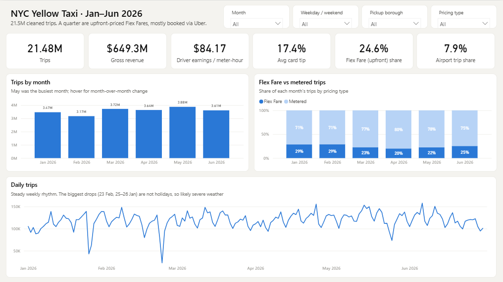

| Demand | Earnings & Tips |
|---|---|
| 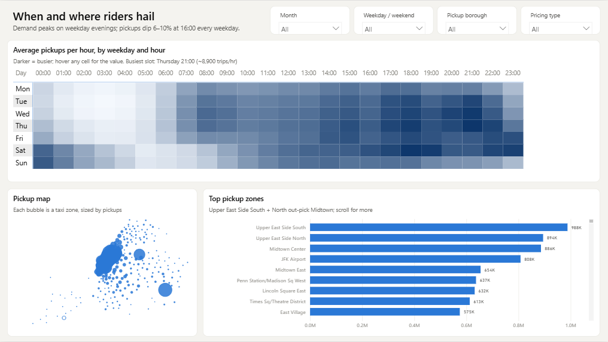 | 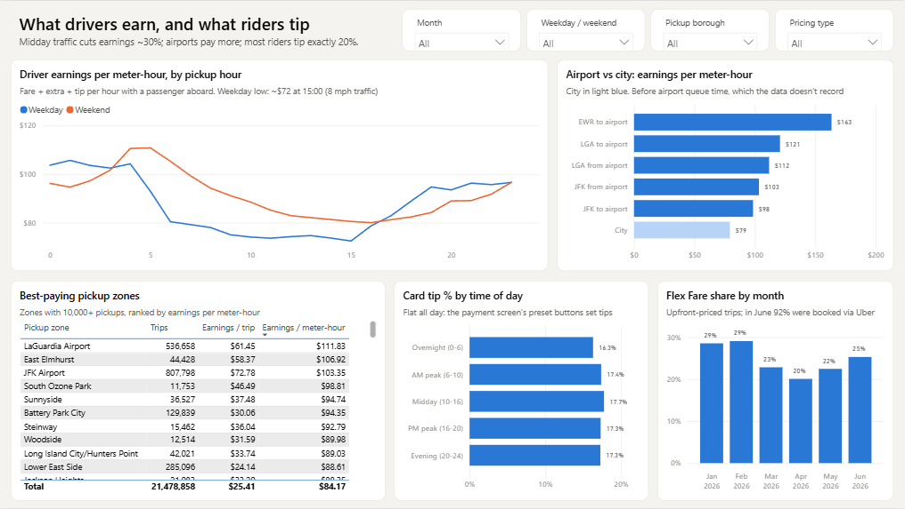 |

**Weekend view.** The same pages with the *Weekday / weekend* filter set to Weekend. Flex Fare share rises to 32%, earnings per meter-hour rise to $87.73 as traffic eases, and the East Village becomes the top pickup zone.

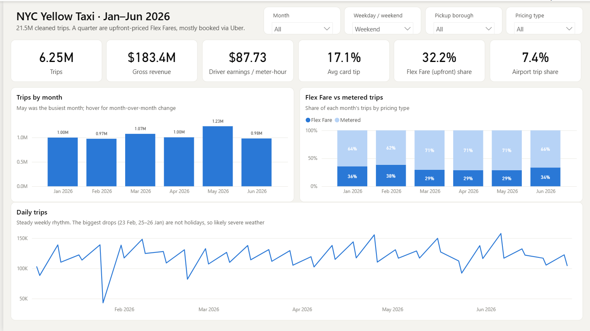
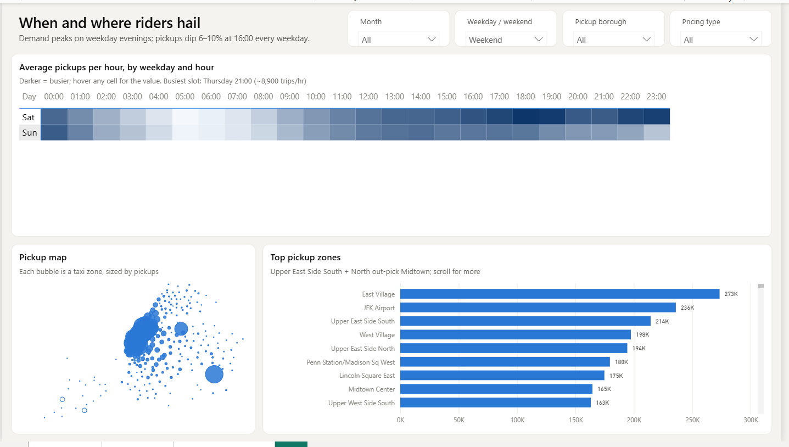


## Key findings

**1. Demand peaks on weekday evenings, not the morning commute.** The busiest slot is Thursday 21:00 (about 8,900 pickups per hour). Tuesday through Thursday 17:00–22:00 is consistently the darkest band, and Saturday evening is close behind. Every weekday, pickups dip 6–10% at 16:00 and rebound at 17:00. There is no dip on Saturday, which points to cabs off the road for shift change.

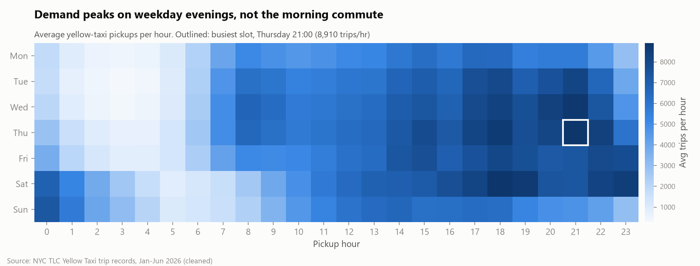

**2. Midday traffic costs drivers about 30% of their hourly earnings.** Weekday earnings per meter-hour fall from about $104 at 1–4am to $72 at 15:00, as average speed drops to 8 mph. Short midday trips aren't the cause: the average fare per trip is roughly flat across the day.

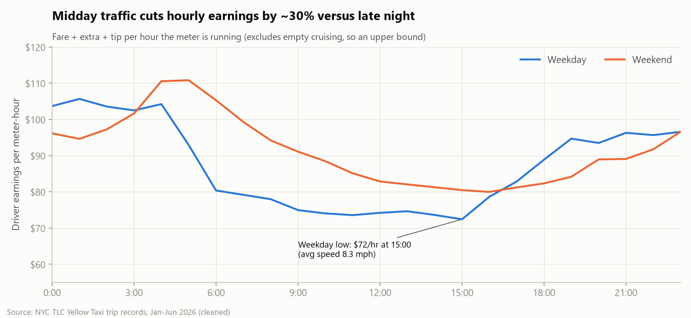

**3. The Upper East Side is the single biggest pickup market.** UES South and UES North together account for 8.8% of all pickups, more than Midtown Center (4.1%). The top origin-destination pairs are short hops within the UES.

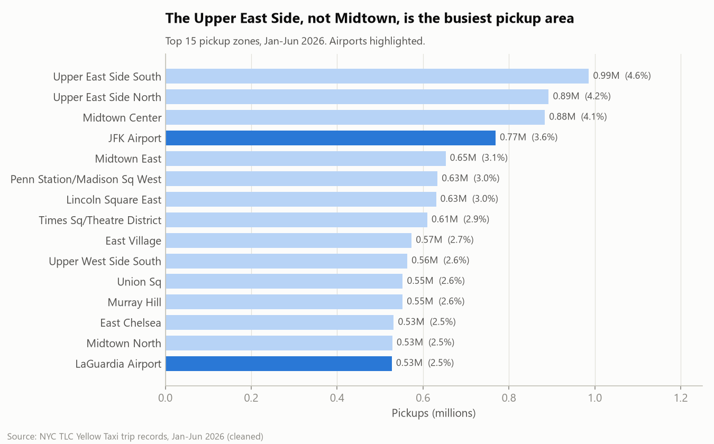

**4. Airport trips earn 25–55% more per meter-hour, before counting the queue.** LGA trips earn $112–121 per meter-hour and JFK trips $98–103, against $79 for city trips. For pickups, time waiting in the airport taxi lot isn't in the data and can cancel out that advantage.

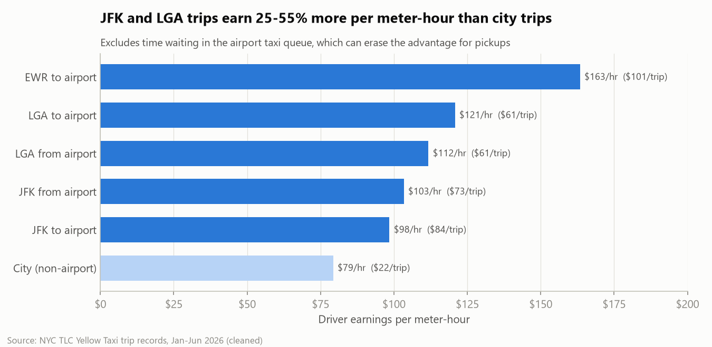

**5. Tips are set by the payment screen, not the ride.** 53% of card riders tip exactly 20%, and most of the rest pick 25%, 15%, 10%, 30% or 0%. Average tip % barely moves across borough, time of day or distance (16.6–18.9%).

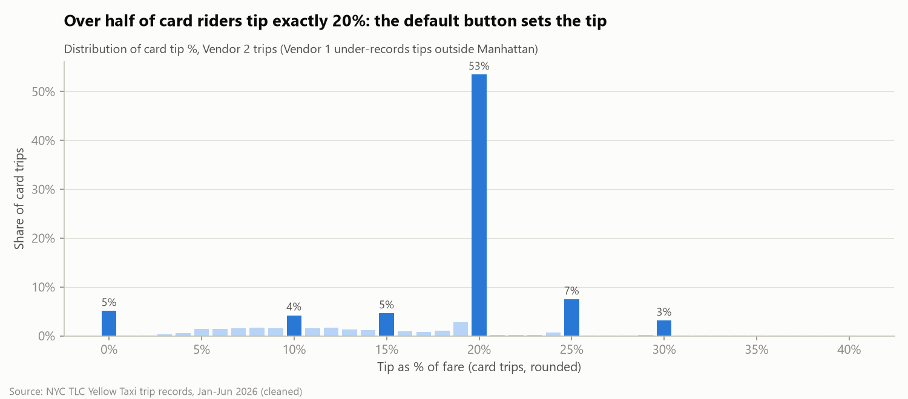

**6. A quarter of yellow-cab trips are upfront-priced Flex Fares, and Uber sells most of them.** Flex Fare made up 20–29% of trips each month. In June, the first month the booking channel was recorded, 92% of Flex trips (23% of all yellow trips) came through Uber (HV0003).

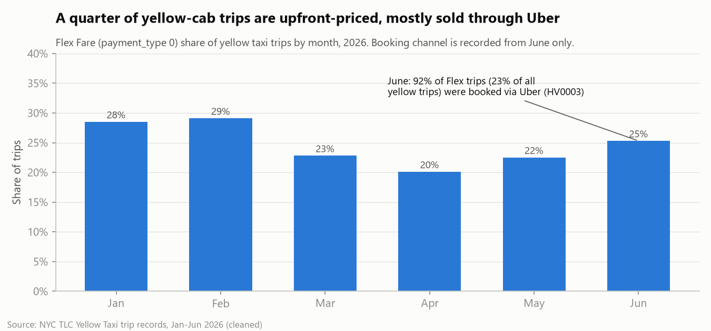

## Data
- [NYC TLC Trip Record Data](https://www.nyc.gov/site/tlc/about/tlc-trip-record-data.page): Yellow taxi monthly Parquet files, Jan–Jun 2026
- Taxi Zone Lookup CSV and zone shapefile (same page)

Put the files in:
```
data/raw/yellow/yellow_tripdata_2026-MM.parquet
data/reference/taxi_zone_lookup.csv
data/reference/taxi_zones.zip
```

## Method
| Step | Code | Output |
|---|---|---|
| Profile & clean (11 drop rules, 3 flag rules) | [src/clean.py](src/clean.py) | `data/interim/trips_clean.parquet`, [reports/cleaning_log.csv](reports/cleaning_log.csv) |
| Feature engineering & zone join | [src/features.py](src/features.py) | `data/processed/trips.parquet` |
| Analysis queries (one SQL file per question) | [sql/](sql/), [src/analysis.py](src/analysis.py) | [reports/tables/](reports/tables/) |
| Charts | [src/charts.py](src/charts.py) | [reports/figures/](reports/figures/) |
| Power BI star schema (1.5M-row aggregate + date/hour/zone dims with lat/lon) | [src/export_powerbi.py](src/export_powerbi.py) | `data/powerbi/*.csv` |
| Power BI project (TMDL model + PBIR report, generated) | [src/build_pbip.py](src/build_pbip.py) | [dashboard/NYC Taxi.pbip](dashboard/) |

Stack: Python, DuckDB (SQL directly on Parquet), pandas, matplotlib, Power BI.

**Driver earnings** = fare + extra (rush-hour/overnight surcharge) + tip. Taxes, congestion fees, airport fees and tolls are pass-throughs and are excluded. **Per meter-hour** divides by time with a passenger aboard. Time spent cruising empty isn't in the data, so this is an upper bound on real hourly pay.

### Data quality
94.1% of raw rows survive cleaning. Each dropped row is counted under the first rule it fails, so the log reconciles exactly to the output.

| Rule | Rows dropped | % of raw |
|---|---:|---:|
| Pickup outside file month | 85 | 0.00 |
| Dropoff not after pickup | 286,181 | 1.25 |
| Duration > 24h | 184 | 0.00 |
| Duration < 1 min | 233,515 | 1.02 |
| Non-positive distance | 538,884 | 2.36 |
| Distance > 100 mi | 908 | 0.00 |
| Vendor 6 fare field not populated | 45,164 | 0.20 |
| No charge / dispute / void | 219,393 | 0.96 |
| Non-positive fare/total or negative tip | 30,493 | 0.13 |
| Fare > $1,000 | 1 | 0.00 |
| Speed > 80 mph | 2,864 | 0.01 |

Kept but flagged: missing passenger count (23.4%, almost entirely Flex Fare trips, where it is null by design), unknown zone (0.6%), store-and-forward (0.1%).

Issues found during analysis:
- **Flex Fare (`payment_type = 0`) is 25% of trips**, with null passenger count and RatecodeID by design. Dropping nulls blindly would have removed a quarter of real trips.
- **Vendor 1 under-records card tips outside Manhattan.** It shows $0 on 97–100% of Bronx and Brooklyn card trips, while Vendor 2 shows 10–25% in the same boroughs. All tip analysis therefore uses Vendor 2 card trips only. Without this, the analysis would wrongly conclude that outer-borough riders don't tip.
- **Vendor 6 (Myle) reports a fare of about $3 on trips totalling about $32**, so its fare field can't be used. Those rows are dropped (0.2%).
- **`request_source` first appears in June 2026.** It's read with `union_by_name`, so earlier months show NULL.

## Reproduce
```powershell
python -m venv .venv
.\.venv\Scripts\pip install -r requirements.txt
.\.venv\Scripts\python -m src.clean
.\.venv\Scripts\python -m src.features
.\.venv\Scripts\python -m src.analysis
.\.venv\Scripts\python -m src.charts
.\.venv\Scripts\python -m src.export_powerbi   # unzip data/reference/taxi_zones.zip first
.\.venv\Scripts\python -m src.build_pbip
```
Then open `dashboard/NYC Taxi.pbip` in Power BI Desktop and refresh (see [dashboard/README.md](dashboard/README.md)).
